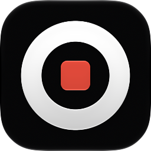

#
<p align="center">

<h1 align="center">QuickRecorder</h1>
<h3 align="center">A lightweight and high-performance screen recorder for macOS<br><a href="./README_zh.md">[中文版本]</a><br><a href="https://lihaoyun6.github.io/quickrecorder/">[Landing Page]</a>
</p>

## Screenshot
<p align="center">
<picture>
  <source media="(prefers-color-scheme: dark)" srcset="./img/preview_en_dark.png">
  <source media="(prefers-color-scheme: light)" srcset="./img/preview_en.png">
  
</picture>
</p>

## Installation and Usage
### System Requirements:
- macOS 26.0 or later
- Developed and tested on macOS 27. macOS 26 builds and links (deployment target 26.0) but has not been run on a 26 machine, so its look and behaviour there are unverified.

### Install:
Download the latest installation file [here](../../releases/latest) or install via Homebrew:

```bash
brew install lihaoyun6/tap/quickrecorder
```

### Features/Usage:
- You can use QuickRecorder to record your screens / windows / applications / mobile devices... etc.

- QuickRecorder supports driver-free audio loopback recording, mouse highlighting, screen magnifier and many more useful features.  
- The new **"[Presenter Overlay](https://support.apple.com/guide/facetime/presenter-overlay-video-conferencing-fctm6333f4bd/mac)"** in macOS 14 was fully supported by QuickRecorder, which can overlay the camera in real time on your recording
- QuickRecorder is able to record `HEVC with Alpha` video format, that can contain alpha channel in the output file *(currently only iMovie and FCPX support this feature)*  

## Q&A
**1. Where can I reopen the main panel after closing it?**
> Click the Dock tile or Menubar icon of QuickRecorder to reopen the main panel at any time.

**2. Why does QuickRecorder not a sandbox app?**
> QuickRecorder has no plans to be uploaded to the App Store, so it does not need to be designed as a sandbox app.  

**3. How to independently control the volume of system sound and sound from microphone in other video editor?**
> QuickRecorder will merge the audio input from the microphone to the main audio track after recording by default. If you need to edit the video, you can turn off the `Record Microphone to Main Track` option in the settings panel. After turning off, the system sound and sound from microphone will be recorded into two audio tracks and can be edited independently.  

## Donate


## Thanks
[Azayaka](https://github.com/Mnpn/Azayaka) @Mnpn
> The source of inspiration and part of the code of the screen recording engine comes from the Azayaka project, and I am also one of the code contributors to this project

[KeyboardShortcuts](https://github.com/sindresorhus/KeyboardShortcuts) @sindresorhus  
> QuickRecorder uses this swift library to handle shortcut key events  

[SwiftLAME](https://github.com/hidden-spectrum/SwiftLAME) @Hidden Spectrum
> QuickRecorder uses this swift library to handle MP3 output

[ChatGPT](https://chat.openai.com) @OpenAI
> Note: Part of the code in this project was generated or refactored using ChatGPT.
